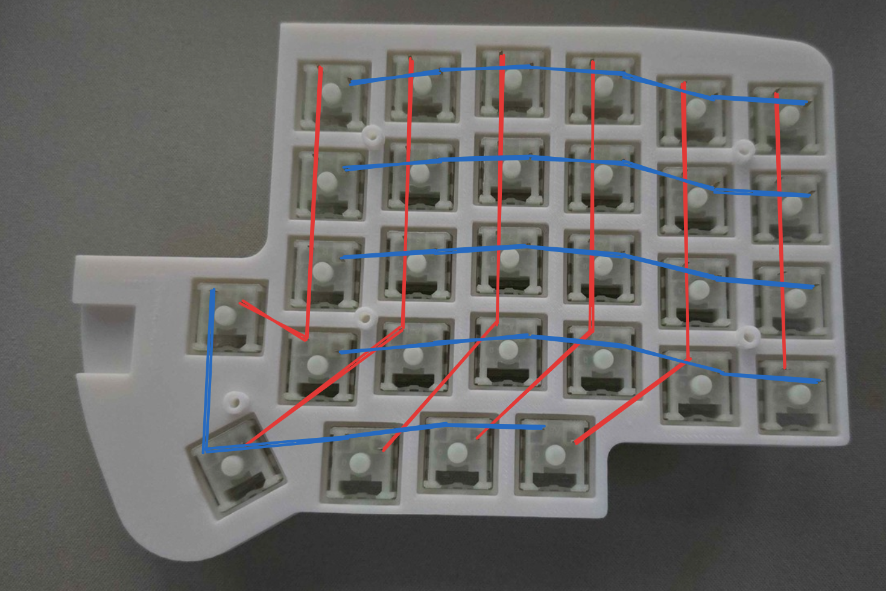
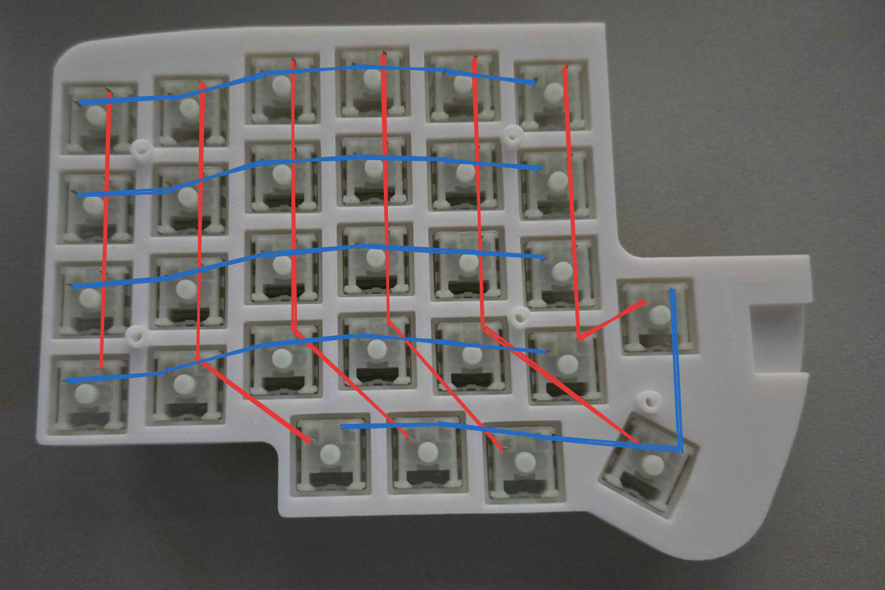
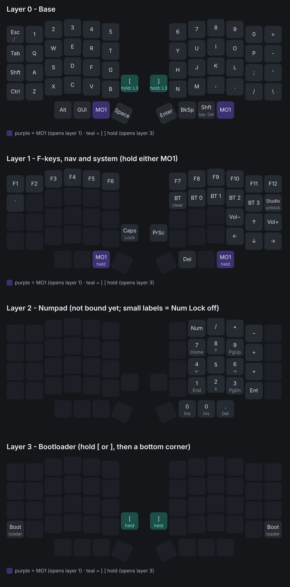

# Lily58 (handwired, wireless)

A handwired, wireless split [Lily58](https://github.com/kata0510/Lily58) running [ZMK](https://zmk.dev) on SuperMini nRF52840 controllers, with a ZMK Studio layout.

<!-- Add a photo of the board here, e.g.  -->

## Features

- Handwired 58-key Lily58 layout (6×4 per half, plus 4 thumb keys and 1 inner key)
- Wireless split over Bluetooth: no TRRS cable. The left half connects to the computer.
- ZMK firmware with **ZMK Studio** support. Remap keys live at [zmk.studio](https://zmk.studio), no re-flashing.
- 3D-printed case

## You will need

| Part | Qty | Notes |
|---|---|---|
| SuperMini nRF52840 (nice!nano v2 clone) | 2 | One per half |
| MX-style switches | 58 | Built with KTT Kang White V3 |
| 1N4148 diodes | 58 | One per switch |
| 103450 LiPo battery (3.7 V, 2000 mAh) | 2 | Search "103450 lipo". Wired to B+ / B− on each controller. |
| JST-PH 2.0 2-pin connector pair | 2 | Search "JST PH 2.0 2 pin". Lets the battery unplug. |
| KCD11 rocker switch (10 × 15 mm) | 2 | Search "KCD11 rocker switch". Power switch between the battery and B+. |
| Wire | — | For rows, columns and battery |
| M2 × 8 mm screws | 10 | |
| M2 × 4 mm screws | 4 | |
| 3D-printed case and plate | 1 set | See [`case/`](case) |

## Wiring

Both halves use the same pins. Diodes are **COL2ROW**: the stripe on each diode faces the **row** wire.

| Row | Pin | Keys |
|---|---|---|
| 0 | P0.22 | Number row |
| 1 | P0.24 | QWERTY row |
| 2 | P1.00 | Home row |
| 3 | P0.11 | Bottom row |
| 4 | P1.04 | Thumbs + inner key |

| Column (outer → inner) | Pin |
|---|---|
| 0 (Tab / Backspace side) | P0.02 |
| 1 | P1.15 |
| 2 | P1.13 |
| 3 | P1.11 |
| 4 | P0.10 |
| 5 (T/G/B and Y/H/N side) | P0.09 |

On the thumb row, the four thumb keys are on columns 1–4, and the inner key is on column 5.

Photos of the wiring (seen from the back, **blue = rows**, **red = columns**):

| Left half | Right half |
|---|---|
|  |  |

## Case

The STL files are in [`case/`](case). They're a remodel of [Handwired Lily58 on Printables](https://www.printables.com/model/1321348-handwired-lily58). The files are for the left half: **mirror them in your slicer** for the right half.

## Flashing

Download the `.uf2` files from [Releases](https://github.com/LogicEgg/Lily58/releases).

1. Put a half into bootloader mode. A USB drive called `NICENANO` appears.
   - Double-tap **RST to GND**, or
   - Hold **[** or **]** and press the bottom corner key on that half (Ctrl on the left, `\` on the right).
2. Copy the matching file onto the drive:
   - Left half: `lily58hw_left-nice_nano_v2-zmk.uf2` (the central half, which pairs with your computer)
   - Right half: `lily58hw_right-nice_nano_v2-zmk.uf2`
3. Pair **Lily58** over Bluetooth.

Keymap changes only need the **left** half re-flashed. A new keymap only loads after `settings_reset` or **Restore Stock Settings** in ZMK Studio; until then, the keyboard keeps whatever layout was last saved in Studio.

## Keymap

- **Layer 0, Base**
  - **Esc / `**: Grave/Escape. Sends Esc, or `` ` `` while Shift or GUI is held.
  - **[ and ]**: Layer-Tap. Tap for the bracket, hold for layer 3.
  - **MO 1** is on both thumbs.
  - **Shft / tap: Del**: Mod-Tap. Hold for Right Shift, tap for Delete.
- **Layer 1, Fn (hold MO 1)**
  - F1–F12, `` ` ``, arrows, volume, Caps Lock, Print Screen and Delete.
  - **BT clear** and **BT 0–3** sit under F7–F11. BT 0–3 switch between paired devices; BT clear forgets the device on the current slot.
  - **Studio unlock** sits under F12.
- **Layer 2, Numpad**: a standard numpad on the right half. No key opens it yet; bind one in Studio to use it.
- **Layer 3, Boot (hold [ or ])**: the bottom corner key on each half restarts that half into the bootloader.

Layers 4–8 are spare slots for Studio.

## ZMK Studio

1. Plug the **left** half in with a USB data cable.
2. Open [zmk.studio](https://zmk.studio) in Chrome or Edge and connect.
3. To unlock, hold **MO 1** and press the key under **F12** (top right, second row).
4. Click **Save** after making changes.

## Troubleshooting

- **The halves won't connect, or Bluetooth acts up:**
  1. Flash `settings_reset-nice_nano_v2-zmk.uf2` to **both** halves.
  2. Re-flash the normal firmware on each half.
  3. Turn both halves on at the same time.
  4. Remove Lily58 from your computer's Bluetooth settings and pair again.

  This also wipes your Studio changes.
- **Windows says "Couldn't connect":** remove Lily58 in Windows, press **MO 1 + BT clear**, then pair again.
- **Keys go over USB instead of Bluetooth:** ZMK prefers USB while plugged in. Unplug to use Bluetooth.

## Credits

- [Lily58](https://github.com/kata0510/Lily58) by kata0510
- Case based on [Handwired Lily58](https://www.printables.com/model/1321348-handwired-lily58) (Printables)
- [ZMK Firmware](https://zmk.dev)
