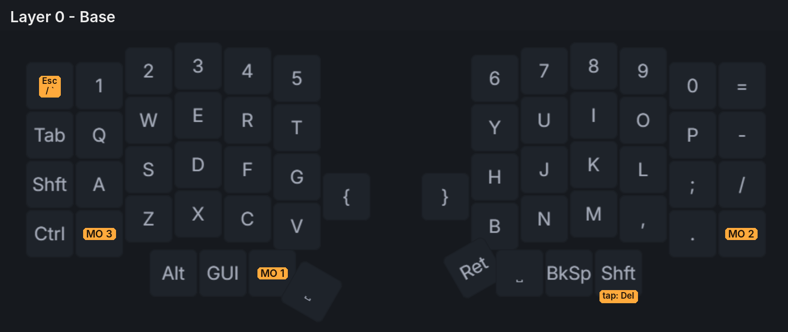
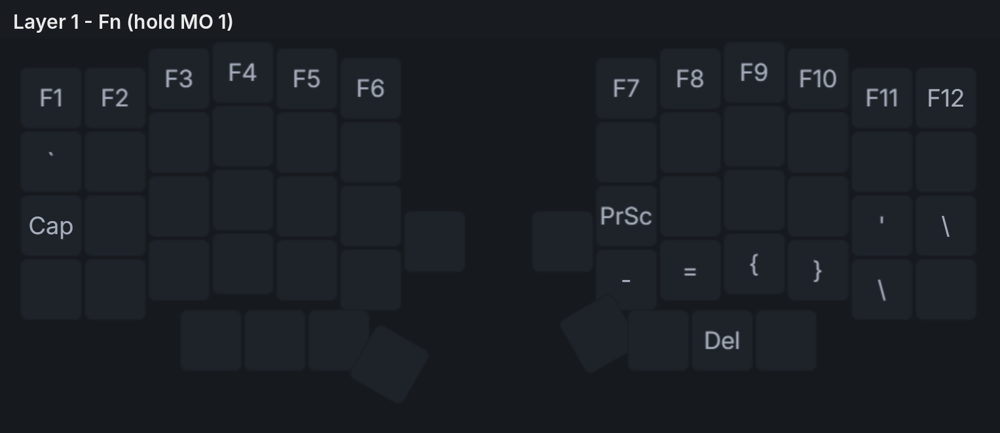
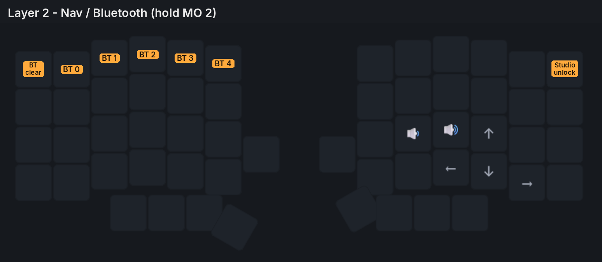
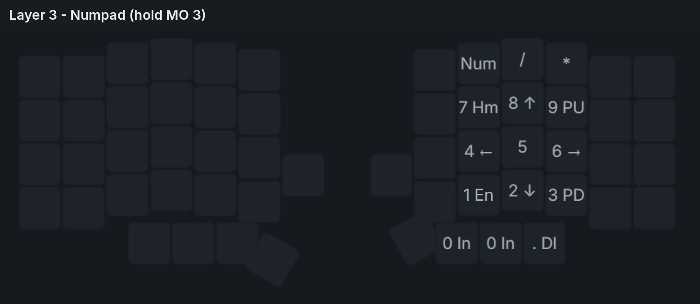

# Lily58 (handwired, wireless)

A handwired, wireless split [Lily58](https://github.com/kata0510/Lily58) running [ZMK](https://zmk.dev) on SuperMini nRF52840 controllers, with a ZMK Studio layout.

<!-- Add a photo of the board here, e.g.  -->

## Features

- Handwired 58-key Lily58 layout (6×4 per half, plus 4 thumb keys and 1 inner key)
- Wireless split over Bluetooth: no TRRS cable. The left half connects to the computer.
- ZMK firmware with **ZMK Studio** support. Remap keys live at [zmk.studio](https://zmk.studio), no re-flashing.
- 9 layers available in Studio (4 used, 5 spare)
- 3D-printed case (`case/`)

## You will need

| Part | Qty | Notes |
|---|---|---|
| SuperMini nRF52840 (nice!nano v2 clone) | 2 | One per half |
| MX-style switches | 58 | Built with KTT Kang White V3 |
| 1N4148 diodes | 58 | One per switch |
| LiPo battery | 2 | Wired to B+ / B− on each controller |
| Power switch | 2 | Optional, between the battery and B+ |
| Wire | — | For rows, columns and battery |
| 3D-printed case and plate | 1 set | See [`case/`](case) |

## Wiring

Both halves use the same pins. Diodes are **COL2ROW**: the stripe on each diode faces the **row** wire.

| Row | Pin | Keys |
|---|---|---|
| 0 | P0.22 | Number row |
| 1 | P0.24 | QWERTY row |
| 2 | P1.00 | Home row |
| 3 | P0.11 | Bottom row |
| 4 | P1.04 | Thumbs + inner key |

| Column (outer → inner) | Pin |
|---|---|
| 0 (Tab / Backspace side) | P0.02 |
| 1 | P1.15 |
| 2 | P1.13 |
| 3 | P1.11 |
| 4 | P0.10 |
| 5 (T/G/B and Y/H/N side) | P0.09 |

On the thumb row, the four thumb keys are on columns 1–4, and the inner key is on column 5.

## Case

The STL files are in [`case/`](case):

- `plate-left.STL`
- `case-left.STL`
- `battery-cover.STL`

The files are for the left half. **Mirror them in your slicer** for the right half.

## Firmware

Download firmware from the GitHub Actions run that matches what you want:

| Build | Keymap |
|---|---|
| [Default keymap](https://github.com/LogicEgg/Lily58/actions/runs/41030529386) | Default keymap (stock starter layout) |
| [Latest keymap](https://github.com/LogicEgg/Lily58/actions/runs/41932546190) | My keybinds (exported from ZMK Studio) |

The [`firmware/`](firmware) folder also has copies of the `.uf2` files.

The keymap only loads after `settings_reset` or **Restore Stock Settings** in ZMK Studio. Until then, the keyboard keeps whatever layout was last saved in Studio.

### Flashing

1. Double-tap **RST to GND** on a half. A USB drive called `NICENANO` appears.
2. Copy the matching file onto the drive:
   - Left half: `lily58hw_left-nice_nano_v2-zmk.uf2` (the central half, which pairs with your computer)
   - Right half: `lily58hw_right-nice_nano_v2-zmk.uf2`
3. Pair **Lily58** over Bluetooth.

Keymap changes only need the **left** half re-flashed.

## Keymap

Hold a layer key (MO) to use that layer.

### Layer 0: Base

- **Esc / `**: Grave/Escape. Sends Esc, or `` ` `` while Shift or GUI is held.
- **Shft / tap: Del**: Mod-Tap. Hold for Right Shift, tap for Delete.

### Layer 1: Fn (hold MO 1)

### Layer 2: Nav / Bluetooth (hold MO 2)

- **BT 0–4**: switch between paired devices. **BT clear** forgets the device on the current slot.
- **Studio unlock**: unlocks ZMK Studio for editing.

### Layer 3: Numpad (hold MO 3)

## ZMK Studio

1. Plug the **left** half in with a USB data cable.
2. Open [zmk.studio](https://zmk.studio) in Chrome or Edge and connect.
3. To unlock, hold **MO 2** and press the **top-right key**.
4. Click **Save** after making changes.

## Troubleshooting

- **The halves won't connect, or Bluetooth acts up:**
  1. Flash `settings_reset-nice_nano_v2-zmk.uf2` to **both** halves.
  2. Re-flash the normal firmware on each half.
  3. Turn both halves on at the same time.
  4. Remove Lily58 from your computer's Bluetooth settings and pair again.

  This also wipes your Studio changes.
- **Windows says "Couldn't connect":** remove Lily58 in Windows, press **MO 2 + BT clear**, then pair again.
- **Keys go over USB instead of Bluetooth:** ZMK prefers USB while plugged in. Unplug to use Bluetooth.

## Credits

- [Lily58](https://github.com/kata0510/Lily58) by kata0510
- [ZMK Firmware](https://zmk.dev)
